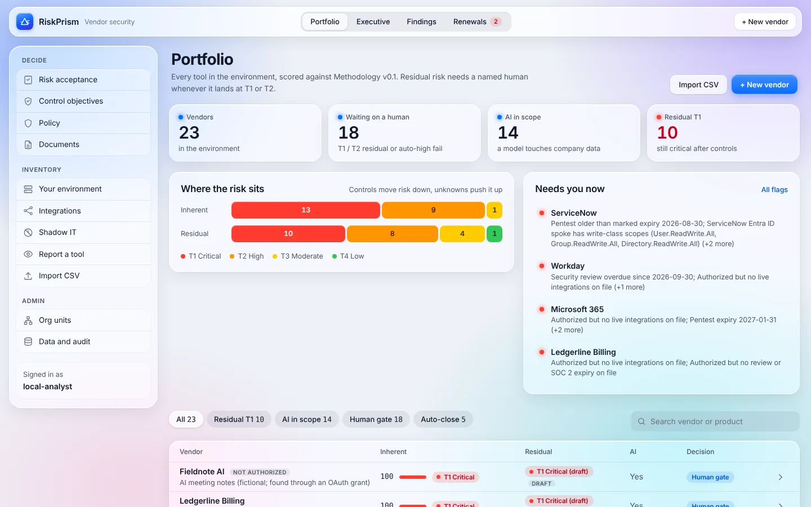
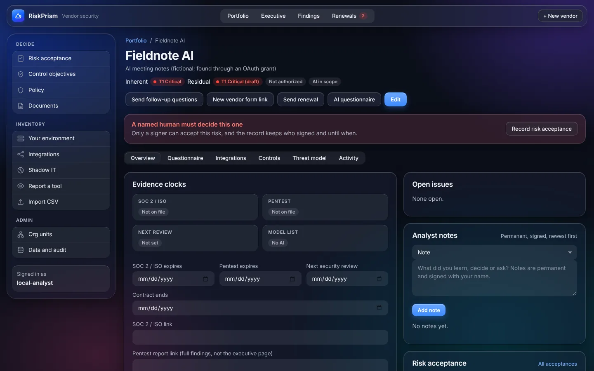

# RiskPrism

[](https://github.com/generalwax2018/riskprism/actions/workflows/test.yml)
[](LICENSE)

Open-source vendor security (third-party risk) for a security team that does **not** know what tools are in the environment.
It is **vendor security only**: inventory, questionnaires, evidence clocks, risk acceptances, live access, findings.
It is not a finance, procurement or GRC suite, or a ServiceNow replacement.

Python standard library only: nothing to `pip install`. Runs on a laptop, a small VM or Azure App Service, with your data in a folder you control. MIT licensed.



Nobody writes or versions a question list. For each vendor, a model reads the vendor's
published security, trust and privacy pages, writes up what it found, and drafts
questions only for what is missing. That includes vendors that are not software: a
printer vendor is asked about data on the device, an HVAC contractor about which systems
it reaches and whether technicians share accounts. The model also requests the
documents the risk calls for; missing ones are flagged at the severity it sets. An
analyst edits and approves everything before the vendor sees it (**AI questionnaire** on
a vendor). Any OpenAI-compatible model works.

Questionnaires go stale the day they are signed, so the app also tracks what a vendor
actually holds in the environment (**Live access**) and flags where that disagrees with
what was assessed: access still live after offboarding, write permissions the vendor
never disclosed, approved vendors with no visible integration. The goal is third-party
risk from questionnaire to live access, including AI tools nobody reviewed.

When a risk is accepted instead of fixed, it is accepted by a named approver, for one
org unit, until a date (**Risk acceptance**). Medium risk needs a director; High and
Critical need a VP or the CISO. Nothing is permanent: when an acceptance expires, its
flag opens again. Org units come from the departments in an Entra ID users export.



The interface follows your system's light or dark setting. What is built and what is not: [docs/STATUS.md](docs/STATUS.md). What comes next: [docs/DESIGN_QUEUE.md](docs/DESIGN_QUEUE.md).

Settings are environment variables named `ENTROPY_*` (the project's earlier name). They stay that way so existing installs keep working.

## Run on your laptop

Python 3.10 or newer. No packages to install.

```bash
git clone https://github.com/generalwax2018/riskprism.git
cd riskprism
python3 serve.py        # on Windows: python serve.py
```

Open http://127.0.0.1:8765. On a laptop it binds to loopback with no login. Anything else needs sign-in, see below.

Run the tests: `python -m unittest discover -s tests -v`

## What to click first

1. **Renewals & evidence** → **Load sample clocks**: four vendors with overdue or soon-due evidence.
2. Open a vendor, choose **New vendor form link**, and open the link in a private window: that is what the vendor sees.
3. **+ New vendor** or **Report a tool**: real intake vs shadow-IT report.
4. On a vendor: set SOC 2 / pentest / next-review dates, upload the report in **Documents** (type, period, valid-until), then **Mark reviewed**. Add an analyst note. **Documents** in the sidebar lists every file across vendors.
5. Open **LeaseAI Abstract** or **SiteCam Field** → **Live access** card: sample OAuth apps and the flags they raise.
6. **Import CSV** → **Import Entra users**: upload an Entra users export. Each department becomes an org unit flagged for review.
7. **Org units**: set each unit's accountable owner, merge duplicates, and add yourself as an approver.
8. Back on a vendor → **Risk acceptance**: accept one flag for one unit, with a tier, justification, compensating controls and an expiry. It shows as Accepted on **Renewals & evidence** and on the **Risk acceptance** dashboard until it expires.

`data/` holds vendor JSON plus `riskprism.db` (SQLite: org units, acceptances, analyst notes, accounts and the audit log). It is gitignored. Demo rows in `vendors.demo.csv` are samples; use **Start tracking this vendor** to turn one into a real record. Before real use, an admin opens **Data and audit** → **Remove sample data**.

## Configuration

Everything is an environment variable. See `.env.example`.

| Setting | Meaning |
|---|---|
| `ENTROPY_AUTH` | `none` (loopback only), `accounts` (per-person login with authenticator MFA, use this for a team), `password` (one shared password, demos only), or `easyauth` (Azure App Service sign-in) |
| `ENTROPY_ANALYST_PASSWORD` | 12+ characters, for `password` mode |
| `ENTROPY_DATA_DIR` | where vendor files, uploads and the audit log live |
| `ENTROPY_BASE_URL` | public HTTPS URL used in vendor links |
| `ENTROPY_HOST` / `ENTROPY_PORT` | bind address and port (`127.0.0.1:8765` by default) |
| `ENTROPY_ADMINS` | sign-in names that may manage people, org units, approvers and data (`analyst` in `password` mode; everyone when `none`). In `accounts` mode admins are normally set on the People page instead |
| `ENTROPY_VIEWERS` | sign-in names that can read and export everything and change nothing (see View-only access). Wins over `ENTROPY_ADMINS` |
| `ENTROPY_ACCEPT_MAX_DAYS` | longest a risk acceptance may run (default 365) |
| `ENTROPY_AI` | `on` (default) or `off`. `off` hides every AI control, refuses model calls and vendor website fetches, even if `LLM_*` is set |
| `ENTROPY_OIDC_ISSUER`, `ENTROPY_OIDC_CLIENT_ID`, `ENTROPY_OIDC_CLIENT_SECRET` | single sign-on for analysts in `accounts` mode (see below) |
| `ENTROPY_SNOW_INSTANCE`, `ENTROPY_SNOW_USER`, `ENTROPY_SNOW_PASSWORD`, `ENTROPY_SNOW_TABLE` | raise findings as ServiceNow records |
| `ENTROPY_JIRA_URL`, `ENTROPY_JIRA_EMAIL`, `ENTROPY_JIRA_TOKEN`, `ENTROPY_JIRA_PROJECT` | raise findings as Jira issues |
| `ENTROPY_JIRA_DUEDATE` | `1` sends each finding's due date to Jira (the project's create screen must have Due date) |
| `ENTROPY_SMTP_HOST`, `ENTROPY_SMTP_PORT`, `ENTROPY_SMTP_TLS`, `ENTROPY_SMTP_USER`, `ENTROPY_SMTP_PASSWORD`, `ENTROPY_SMTP_FROM` | optional outgoing email (see Email). Off until `ENTROPY_SMTP_HOST` is set; `ENTROPY_SMTP_FROM` is then required. Port `587` and `starttls` by default |
| `ENTROPY_DIGEST`, `ENTROPY_DIGEST_TO` | weekly digest: `weekly` (default when email is on) or `off`, and extra comma-separated recipients |
| `ENTROPY_BACKUP`, `ENTROPY_BACKUP_DIR`, `ENTROPY_BACKUP_KEEP` | nightly backup: `daily` (default) or `off`, where to write it (default `DATA_DIR/backups`), how many to keep (default 14) |

The server refuses to start on a non-loopback address without sign-in, and refuses unknown `ENTROPY_AI`, `ENTROPY_SMTP_TLS`, `ENTROPY_DIGEST` and `ENTROPY_BACKUP` values. The startup lines include `Backups:` and `Email:`, so you can see what is switched on. Signing a risk acceptance needs a per-person identity (`accounts`, `easyauth`, or `none` on a laptop); the shared `password` login can view and administer but not sign.

### Accounts mode (per-person sign-in)

`ENTROPY_AUTH=accounts` gives every analyst their own email, password and authenticator app (Microsoft Authenticator, Google Authenticator, 1Password...). Create the first admin from the server's shell, with the same environment as the service:

```bash
python accounts.py invite you@example.com --admin --name "Your Name"
```

It prints a one-time setup link (72 hours). Open it, set a password, scan the QR code and enter the 6-digit code. After that, admins invite, reset, disable, promote and make people view-only on the **People** page (the invite link is emailed when email is set up). `python accounts.py list` and `python accounts.py reset EMAIL` work from the shell too, for example if the only admin loses their phone.

### Single sign-on (OIDC)

In `accounts` mode, analysts can sign in with Microsoft Entra ID, Okta, Google Workspace or any OpenID Connect provider. Register an app with the redirect URI `<ENTROPY_BASE_URL>/login/sso/callback`, then set:

```bash
ENTROPY_OIDC_ISSUER=https://login.microsoftonline.com/<tenant-id>/v2.0   # or https://yourco.okta.com, https://accounts.google.com
ENTROPY_OIDC_CLIENT_ID=...
ENTROPY_OIDC_CLIENT_SECRET=...
# ENTROPY_OIDC_LABEL="Sign in with Microsoft"
# ENTROPY_OIDC_ONLY=1        # switch off password sign-in once everyone uses SSO
```

People still need an account: invite them on the **People** page (or `python accounts.py invite`). Their first SSO sign-in activates it, and no password or authenticator setup is needed. Disabled accounts cannot sign in.

### View-only access

For auditors, executives or anyone who should look but not touch. A view-only person can open every page and download exports, reports and documents. Every change they try is refused with 403 and written to the audit log as `view_only_refused`. They can still sign out and change their own password.

- `accounts` mode: on the **People** page choose **Make view-only** (and **Allow changes** to undo it), or pick **View only** under **Access** when you invite someone.
- `easyauth` and other modes: list sign-in names in `ENTROPY_VIEWERS`.

A person cannot be admin and view-only at once. Someone in both `ENTROPY_ADMINS` and `ENTROPY_VIEWERS` is view-only.

### Without AI

Set `ENTROPY_AI=off`. The AI questionnaire button, "Ask AI for a date" and the AI routes go away, and the code refuses model calls and vendor website fetches. Everything else is rules and forms already: fixed onboard and renewal questionnaires, follow-up flags, threat models, integrations, control objectives and findings.

### Tickets

`/findings` lists everything that needs action. With the ServiceNow or Jira variables set, tick findings and choose **Create tickets**. Each finding is raised once, and its ticket number shows on the worklist. Without them, **Download CSV** gives a file both tools import.

Each finding has a first-seen date and a due date from your own rule under **Your environment** (fix high, medium and low within 30, 90 and 180 days by default). The worklist shows days open and days overdue, an **Overdue** count and a trend line against about a month ago. The CSV adds First seen, Due and Days overdue, ServiceNow records get `due_date`, and Jira issues get `duedate` when `ENTROPY_JIRA_DUEDATE=1`.

### Email

Optional, and off until `ENTROPY_SMTP_HOST` and `ENTROPY_SMTP_FROM` are set. It uses Python's own `smtplib`.

```bash
ENTROPY_SMTP_HOST=smtp.sendgrid.net
ENTROPY_SMTP_PORT=587               # default; ENTROPY_SMTP_TLS=starttls is the default too
ENTROPY_SMTP_USER=apikey
ENTROPY_SMTP_PASSWORD=...
ENTROPY_SMTP_FROM="Acme Security <security@acme.example>"
# ENTROPY_DIGEST=off                # no weekly digest
# ENTROPY_DIGEST_TO=ciso@acme.example   # extra digest recipients
```

What it sends, and only these:

- A vendor's questionnaire link, when an analyst types the address on the share page and chooses **Send email**. Replies go to the security contact set under **Your environment**.
- A new person's one-time setup link, when the admin leaves **Email the one-time link to them** ticked on the **People** page.
- A weekly digest of counts and the top decisions, on Monday after 08:00 server time, to active admins (accounts mode) and `ENTROPY_DIGEST_TO`.

Messages are plain text with no tracking. `ENTROPY_SMTP_TLS=none` is accepted only for a mail server on the same machine. **Data and audit** has **Send a test** and **Send the digest now**. Without email, the share page shows a ready-to-send message with **Copy message**, and the People page shows the invite link to send yourself.

Vendors are more likely to answer a request they can check. Set **Organisation name** and **Security contact shown to vendors (email)** under **Your environment**: the vendor form and the message then say who is asking, that you use RiskPrism (why the form is on this address), who sent it, the deadline, and who to write to if it was unexpected.

### Backups, export and delete

Admins have a **Data and audit** page in the sidebar (`/admin/data`).

- **Backups.** Once a day, at the first check after 02:00 server time (it checks every 15 minutes), the app writes a `.tar.gz` of the data folder to `ENTROPY_BACKUP_DIR` (default `DATA_DIR/backups`) and keeps the newest `ENTROPY_BACKUP_KEEP` (14). Databases are copied with SQLite's online backup, so the copy is consistent while the server runs. Point `ENTROPY_BACKUP_DIR` at a mounted Azure Files share or another disk, so losing the server does not lose its backups. **Back up now** and the download links are on the page; `python3 ops.py backup` works from the shell.
- **`secret.key` is not in the backups.** Keep one copy of it (or of `ENTROPY_SECRET`) somewhere separate, such as Key Vault or a password manager. Without it, restored authenticator apps stop working and the audit log no longer verifies.
- **Restore.** Run with the same environment as the service:

  ```bash
  sudo systemctl stop entropy
  # new server? copy your saved secret.key into the data folder first: a new server makes its own key, which will not match
  python3 ops.py restore /path/to/riskprism-YYYYMMDD-HHMMSS.tar.gz --force
  sudo systemctl start entropy
  ```

  The current contents are moved into a `before-restore-<stamp>` folder inside the data folder, never deleted; remove it yourself once the restore checks out. If the backup was made with a different server key, the restore says so. A backup with unsafe paths is refused.
- **Export everything** (`.zip`): vendor JSON, documents, the JSON stores, and CSVs of findings, risk acceptances, notes, org units, approvers, people (accounts mode) and the audit log, plus the result of an audit seal check. No passwords, authenticator secrets, vendor link tokens or server key.
- **Remove sample data**: demo vendors, sample integrations, the sample environment if nobody changed it, sample shadow IT imports and demo live-access rows. Your own data stays.
- **Delete all data**, when you are finished with an instance: type `DELETE ALL DATA`. It removes vendors, documents (including their Azure Blob copies when Azure storage is on), answers, stores, policy, notes, risk acceptances, org units, approvers, vendor links, earlier `before-restore-*` copies and the audit log, which restarts with one `audit_log_wiped` entry. People's accounts and `secret.key` stay. A ticked-by-default box also deletes the backups on the server; copies you made elsewhere are yours to delete.

The page also shows the audit log's entry count and latest seal, with **Check the seals now** and a CSV download. `python3 ops.py verify-audit` does the same check from the shell. See `SECURITY.md` for what the seals prove.

## Deploy

See [docs/AZURE_DEPLOY.md](docs/AZURE_DEPLOY.md) for App Service (Entra sign-in) and a small VM behind Caddy. A `Dockerfile` is included. Run **one instance** only.

## Docs

| File | What it is |
|---|---|
| [SECURITY.md](SECURITY.md) | What was fixed, what is still your job |
| [docs/ARCHITECTURE.md](docs/ARCHITECTURE.md) | Process, modules, request flow, routes |
| [docs/WORKFLOWS.md](docs/WORKFLOWS.md) | Find → Clock → Ask less → Compare → Sign or stop |
| [docs/DATA_MODEL.md](docs/DATA_MODEL.md) | Files on disk and vendor JSON fields |
| [docs/AZURE_DEPLOY.md](docs/AZURE_DEPLOY.md) | Azure deployment |
| [docs/AZURE.md](docs/AZURE.md) | Azure cost and isolation summary |
| [docs/STATUS.md](docs/STATUS.md) | What is in and out |
| [docs/THREAT_MODEL.md](docs/THREAT_MODEL.md) | Per-vendor threat model, diagram, exports |
| [docs/INTEGRATIONS.md](docs/INTEGRATIONS.md) | Integrations data layer: scopes, flows, findings, questions |
| [docs/DATA_LAYER.md](docs/DATA_LAYER.md) | Environment, control objectives, anticipated connections, catalog, shadow IT, executive view, findings |
| [docs/ACCESS_MODULE.md](docs/ACCESS_MODULE.md) | Live access module: data shape, rules, roadmap |
| [docs/AI_QUESTIONNAIRE.md](docs/AI_QUESTIONNAIRE.md) | AI-drafted questions from the vendor's published pages, guardrails, model settings |
| [docs/RISK_ACCEPTANCE.md](docs/RISK_ACCEPTANCE.md) | Org units, Entra import, approval tiers, expiry, dashboard |
| [docs/POLICY.md](docs/POLICY.md) | Restricted models and regions |
| [docs/GROK_INTEGRATION.md](docs/GROK_INTEGRATION.md) | Optional model help and its risks |
| [docs/DESIGN_QUEUE.md](docs/DESIGN_QUEUE.md) | Roadmap: what to build next, in order |
| [docs/PRODUCT_SCOPE.md](docs/PRODUCT_SCOPE.md) | Objects, factsheet, trial clocks |
| [CONTRIBUTING.md](CONTRIBUTING.md) | How to propose a change |
| [CHANGELOG.md](CHANGELOG.md) | What changed, by version |

## Product rules (do not violate)

- Thin intake. Do not invent architecture from the company name.
- A human signs T1 / high residual and every risk acceptance. Drafted tiers are labelled draft.
- Risk acceptances belong to an org unit, need the right approver for their tier, and always expire.
- Renewal pack is not the onboarding pack.
- No spend / PO as a first-class object.
- Vendors use expiring magic links. Analysts sign in.
- Unknown is not a pass. Ambiguous answers become questions for a person.
- Detection is rules, not a model. A model may draft or classify; it never changes a score, resolves a flag, or offboards.

## Contributing

Issues and pull requests are welcome. Read [CONTRIBUTING.md](CONTRIBUTING.md) first; security problems go through a private advisory ([SECURITY.md](SECURITY.md)), not an issue.

## License

MIT, see [LICENSE](LICENSE). `qrcodegen.py` is Project Nayuki's QR Code generator, also MIT; see [THIRD_PARTY.md](THIRD_PARTY.md).
