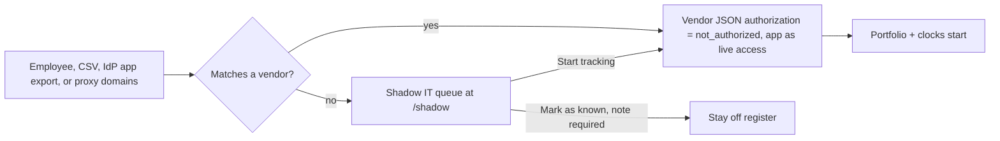
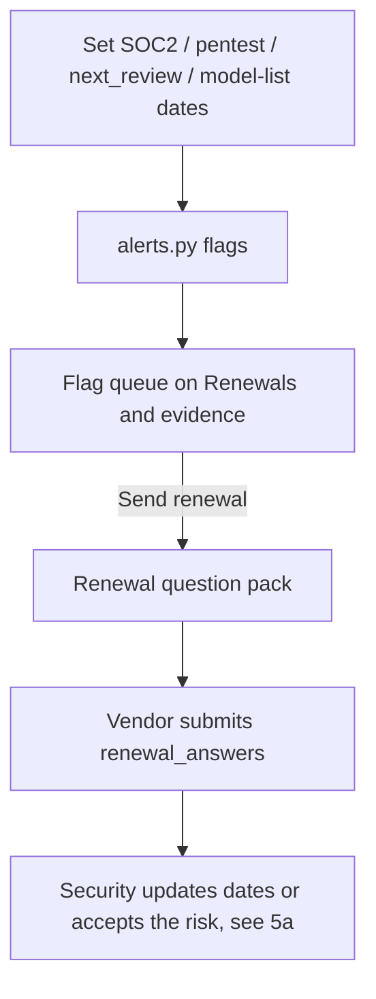
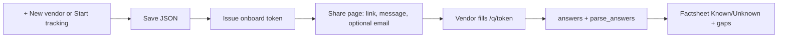
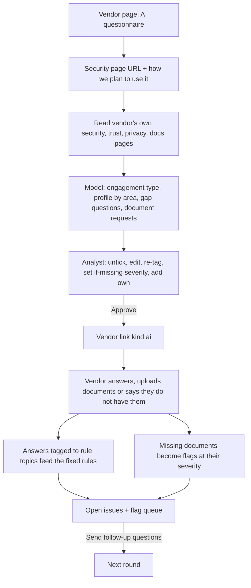
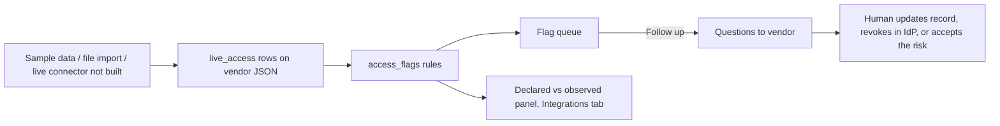
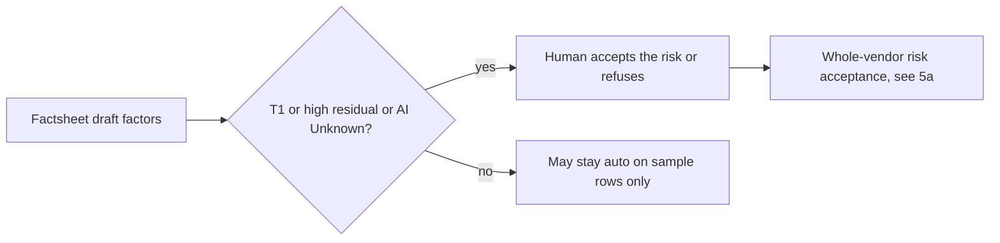
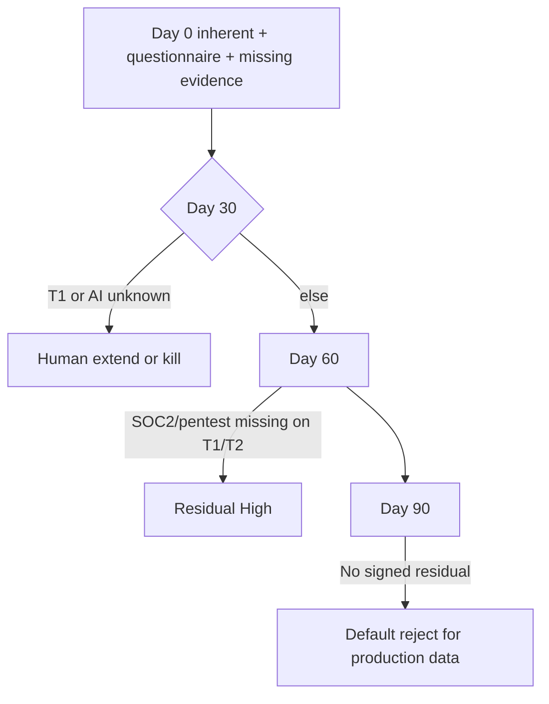
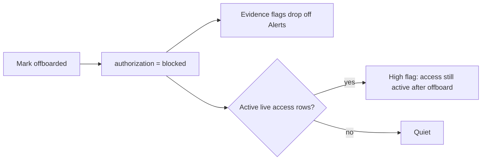
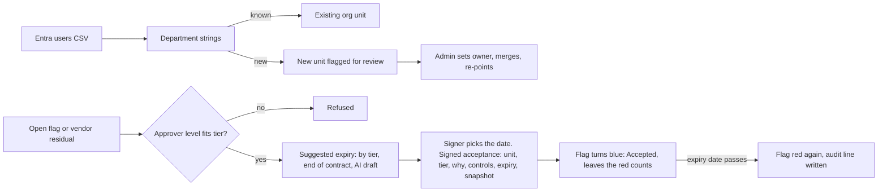

# Workflows

The product is one loop. Sidebar verbs: Find · Clock · Ask less · Compare · Sign or stop.
Admin holds policy, import, and audit.

## 1. Find — shadow IT or unregistered AI shows up

Report a tool and CSV import also feed this step.

The shadow IT queue (`/shadow`, `shadow.py`) takes two files: an organisation-wide connected-app export from Entra, Okta or Google, and a proxy, firewall or gateway export of domains. It sorts what it finds into four kinds: unknown app, vendor not authorized, approved vendor with the connection not recorded, and shadow SaaS seen in web traffic. Matching is by name, app ID and catalog domains. No model is used. **Start tracking** creates the vendor with the app attached as live access. **Mark as known** needs a note. See `docs/DATA_LAYER.md`.

Thin intake: do not invent architecture from the company name.

## 2. Clock — evidence dates start the day it is tracked

Flag rules (see `alerts.py`):

- Date in the past → high
- Date within 90 days → medium
- Renewal questionnaire sent, no submit → medium
- Authorized with no clock at all → medium
- Offboarded / blocked → no evidence flags (live access after offboard still flags, see 4 and 5)
- Access flags from `access_flags.py` join the same queue

## 3. Ask less — onboard known vendor, gaps only

This is the fixed questionnaire. It is still available, and it is the fallback when no
model is configured. The main path is now 3a.

Queued: also generate the pack from evidence gaps + factsheet Unknowns. Prefill and lock what we already have. Only send blanks.

### 3a. AI questionnaire

- The model proposes and an analyst approves. The model never changes a score, clears
  a flag or sends anything.
- It asks only what fits the engagement. A SaaS gets data flow and AI questions, a
  printer vendor gets device questions, an on-site contractor gets badge, access and
  account questions.
- On an AI questionnaire, "No SOC 2" and "No pentest" flags fire only when those
  documents were asked for.
- A person closes a document flag after checking the upload. The app does not close it
  on its own.

See `docs/AI_QUESTIONNAIRE.md`.

## 4. Compare — live access drifts from the assessment

Rules (see `access_flags.py`, no model calls):

- Offboarded / blocked and access still `active` → high
- Authorized with no live access on file → medium (blind spot, not an incident)
- Active app with write-class scopes the questionnaire never mentioned → medium

Declared vs observed panel (vendor Integrations tab, `integrations.drift()`): for each recorded integration with an app ID, the scopes declared on the record against the scopes the imported identity-provider export shows. Red is granted but never declared (it also raises the `scope_drift` finding), amber is declared but not granted, green matches. Live apps that no integration records are listed as not recorded. See `docs/INTEGRATIONS.md`.

Queued (`docs/DESIGN_QUEUE.md` §2): Accept the risk and a typed “sign anyway” straight from that panel, and the Grant glyph on the portfolio. Today a risk is accepted from the Risk acceptance card on the vendor.

Accepting the risk does not clear the flag. It turns blue (Accepted) until its expiry date, then red again. See 5a.

## 5. Sign or stop — residual, trial, offboard

Onboarded vendors are always `human_required` on the portfolio today. A whole-vendor acceptance's tier can be no lower than the residual tier (T1 = Critical, T2 = High).

Trial clocks (queued, `docs/PRODUCT_SCOPE.md`):

Agents remind. Agents do not extend T1 trials. The bar never auto-greens.

Offboard:

Purge deletes the JSON after the analyst types the vendor's name. Offboard keeps the record for audit and revokes the vendor's links. RiskPrism does not revoke IdP grants.

### 5a. A risk is accepted, then expires

Rules (see `risk_rules.py`):

- Low / Medium: director, VP or CISO. High / Critical: VP or CISO.
- The tier can be no lower than the flag (high flag = at least High).
- Expiry is required, not in the past, and at most `ENTROPY_ACCEPT_MAX_DAYS` out.
- Signed rows are never edited or deleted. A new acceptance for the same flag supersedes the old one.

Decided 2026-09-30: an acceptance is an exception, never a pass. There is no "this is
fine" sign-off. A flag has three states:

| State | How it gets there | How it looks |
|---|---|---|
| Open | A rule fires | Red. Glyph lit, row is disagreement, counted in Waiting on a human |
| Accepted | "Accept the risk" signed, still in date | Blue (its own shade, not the Low blue). Glyph stays, shows "accepted until <date> by <name>". Not counted as red |
| Clear | The fact behind the rule changed (access revoked, scope disclosed, evidence uploaded) | Normal. The rule stopped firing on its own |

A wrong rule is fixed by correcting the record, not by accepting it.

Expiry is always set by the person signing. The form offers suggestions they can click
or ignore:

- By tier (deterministic, `risk_rules`): Critical 30 days, High 60, Medium 90, Low 180,
  never past `ENTROPY_ACCEPT_MAX_DAYS`.
- End of contract, when the vendor record has `contract_end` and it is in range.
- AI draft: the model reads the flag, the vendor's answers and follow-ups (for example
  "SOC 2 Type II report expected 15 Jan") and proposes a date with a one-line reason.
  It only fills the suggestion; it never picks the date or signs.

## 6. Who types what

| Actor | Screens |
|---|---|
| Employee | Report a tool |
| Security analyst | Find (shadow IT queue), portfolio, alerts, intake, record, clocks, declared vs observed, integrations, control objectives, findings worklist and tickets, executive summary, threat model, AI questionnaire (research, review, approve), Entra import, live access import, Risk acceptance dashboard, purge |
| Approver (director / VP / CISO) | Risk acceptance card on a vendor |
| Admin (`ENTROPY_ADMINS`, or admin on the People page in `accounts` mode) | Org units: owners, merges, department strings, approvers; People: invite, reset, disable, view-only; Data and audit: backups, audit seals, export, remove sample data, email test and digest, delete all |
| View-only (People page, or `ENTROPY_VIEWERS`) | Every analyst page and download, no changes. Each attempt is refused and logged |
| Vendor | `/q/<token>` only: answers, and document uploads on an AI questionnaire |

Analyst pages need sign-in. On a laptop (`ENTROPY_AUTH=none`, loopback only) the person at the keyboard is the analyst. On a network the server requires `accounts`, `password` or `easyauth`, and refuses to start otherwise. In `accounts` mode analysts can also sign in with OpenID Connect single sign-on. The vendor form needs only a valid magic link, which expires and is replaced when a new one is issued. The form names the customer, who sent it, the deadline and a contact, so the vendor can check the request before answering. See `SECURITY.md`.

## 7. Disagreement on the portfolio

Queued (`docs/DESIGN_QUEUE.md` §1): each row shows Clock, Grant, and Spark glyphs. Any open glyph paints the row red (disagreement). A glyph whose flag is accepted shows blue and does not paint the row red. Spark = AI factsheet Unknown on a required field, or the vendor arrived from the shadow IT queue as an AI app.
Home shows **Waiting on a human: N**.
